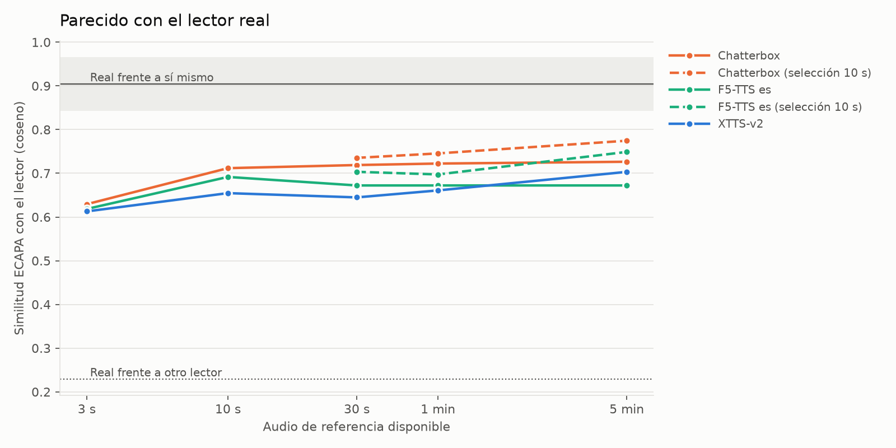

# 19 — Voice Ladder

How much reference audio does a local zero-shot voice cloner need before the
clone sounds like the same person? This project climbs a ladder of reference
lengths (3 s → 10 s → 30 s → 1 min → 5 min) for three open Spanish-capable
cloners on an RTX 3090 and measures speaker similarity, intelligibility,
audio quality and cost against real recordings of the same sentences.

**Headline:** past ~10 s, feeding a cloner more raw audio barely helps.
What helps is using the extra minutes to **pick a better 10 s**: choosing the
most representative window out of 5 min lifts Chatterbox from 0.712 to
**0.775** speaker similarity, the best result in the benchmark. A real speaker
compared with themselves scores 0.904.



## Setup

| | |
|---|---|
| **Voices** | 4 readers from the Spanish test split of [Multilingual LibriSpeech](https://huggingface.co/datasets/facebook/multilingual_librispeech) (LibriVox audiobooks, CC BY 4.0, 16 kHz): 3471 and 10667 (male), 97 and 7510 (female) |
| **Reference ladder** | 3 s · 10 s · 30 s · 1 min · 5 min of consecutive speech per reader |
| **Test sentences** | 10 per reader, held out from the reference (another chapter where the reader has one), each with the real recording as ground truth |
| **Hardware** | NVIDIA RTX 3090, Windows, everything local |
| **Samples** | 840 generated clips |

### Models

| Model | How it uses the reference |
|---|---|
| [XTTS-v2](https://github.com/idiap/coqui-ai-TTS) (coqui-tts 0.27) | Splits the whole reference into 6 s chunks and averages them, so every second counts |
| [Chatterbox Multilingual](https://github.com/resemble-ai/chatterbox) (0.1.7) | Uses only 6–10 s for prompt tokens and decoder conditioning; the speaker embedding sees everything |
| [F5-TTS](https://github.com/SWivid/F5-TTS) + [Spanish checkpoint](https://huggingface.co/jpgallegoar/F5-Spanish) | Cuts the reference to ≤12 s at silences and transcribes it with Whisper |

Because Chatterbox and F5 ignore most of a long reference, they run in two
variants:

- **Raw:** the reference as is; the model keeps whatever it keeps.
- **Selection:** from the 30 s / 1 min / 5 min reference, the 10 s window whose
  ECAPA embedding is closest to the reader's mean embedding is passed instead.

### Metrics

| Metric | Measures | Tool |
|---|---|---|
| Speaker similarity | Does it sound like the reader? | ECAPA-TDNN cosine vs the reader's centroid (leave-one-out) |
| Consistency | Does it hold across sentences? | Std. dev. of similarity within each reader |
| ΔWER | Is it intelligible? | Whisper large-v3-turbo WER of the clone minus WER of the real recording |
| DNSMOS | Is the audio broken? | DNSMOS P.808 |
| Cost | Speed and memory | Real-time factor and peak VRAM |

ΔWER is relative because several texts are archaic (Don Quijote) or dialectal
and Whisper also stumbles on the originals (real WER 0.037).

## Results

Ceiling (real reader vs themselves): **0.904**. Floor (vs other
readers): **0.229**.

| Series | 3 s | 10 s | 30 s | 1 min | 5 min |
|---|---|---|---|---|---|
| Chatterbox, raw | 0.629 | 0.712 | 0.719 | 0.722 | 0.726 |
| Chatterbox, selection | | | 0.735 | 0.745 | **0.775** |
| F5-TTS es, raw | 0.618 | 0.692 | 0.672 | 0.672 | 0.672 |
| F5-TTS es, selection | | | 0.703 | 0.697 | 0.749 |
| XTTS-v2 | 0.613 | 0.655 | 0.645 | 0.661 | 0.703 |

| Model | ΔWER (typical) | DNSMOS | RTF | Peak VRAM |
|---|---|---|---|---|
| Chatterbox | ≈ 0 | 4.0 | 0.66 | 4.1 GB |
| F5-TTS es | +0.04 to +0.11 | 4.0 | 0.16 | 2.4 GB |
| XTTS-v2 | ≈ +0.01 | 4.0 | 0.20 | 2.8 GB |

Full tables: [`resultados/resumen.md`](resultados/resumen.md). Charts:
[consistency](resultados/consistencia.png), [ΔWER](resultados/wer.png),
[DNSMOS](resultados/dnsmos.png), [cost](resultados/coste.png).

## Findings

1. **The knee is at ~10 s.** Every model jumps from ~0.62 at 3 s to ~0.70 at
   10 s. After that, raw audio adds little: Chatterbox gains 0.014 from 10 s to
   5 min.
2. **More audio is worth it as a pool to choose from.** Selecting the best
   10 s window out of 5 min beats feeding 5 min raw: +0.05 for Chatterbox,
   +0.08 for F5. Reader 10667 gains the most (0.664 → 0.790 on Chatterbox):
   the first seconds of a recording are not always representative.
3. **XTTS-v2 is the only model that uses all of a long reference**, and it is
   the only raw curve still rising at 5 min, but it starts lower and never
   catches up with the selected Chatterbox.
4. **Blind clipping can break a clone.** For reader 7510, F5's own silence
   clipping on the ≥30 s references kept the chapter title ("Salmo 37") and a
   pause. The reference text no longer matched the audio and ΔWER jumped to
   +1.62 for that reader. The 3 s and 10 s references, which start mid-speech,
   were fine.
5. **No model reaches the ceiling.** The best average is 0.775 against 0.904.
   Reader 3471 comes close (0.908 vs 0.939), but that reader's test and
   reference come from the same chapter, which flatters the result.
6. **Cost is a non-issue on a 3090.** Every model runs faster than real time
   in ≤4.1 GB of VRAM. F5 is 4× faster than Chatterbox.

## Limitations

- 4 readers × 10 sentences = 40 clips per point; differences of ±0.01 are
  within noise.
- ECAPA similarity is a proxy for "sounds like"; no listening test yet.
- DNSMOS targets noise and distortion, not prosody, so it only flags broken
  audio.
- Readers 3471 and 97 have a single chapter in the split, so their test and
  reference share recording conditions.
- 7510's gender was estimated from pitch (~190 Hz).
- F5 output duration is set from each reader's speaking rate (chars/s in MLS)
  because its built-in estimate depends on the Whisper transcript of the
  reference and blew past the model's limit once.

## Running it (Windows)

```
python scripts/preparar_dataset.py --excluir 8306 8585        # MLS → ladder + test set
powershell -ExecutionPolicy Bypass -File instalar.ps1          # 4 venvs, Python 3.11
.venv-metricas\Scripts\python scripts\seleccionar_referencias.py
.venv-xtts\Scripts\python scripts\generar.py --modelo xtts --limite 10
.venv-chatterbox\Scripts\python scripts\generar.py --modelo chatterbox --limite 10
.venv-f5\Scripts\python scripts\generar.py --modelo f5 --limite 10
.venv-metricas\Scripts\python scripts\medir.py
.venv-metricas\Scripts\python scripts\graficar.py
```

Run the generators one after another, not in parallel, or the RTF numbers
are inflated. XTTS-v2 asks you to accept its non-commercial CPML licence on
first use. `--modelo prueba` runs the whole chain with a fake model and no GPU.

## Structure

```
scripts/        preparar_dataset, seleccionar_referencias, generar, medir, graficar
requirements/   per-venv dependencies (xtts, chatterbox, f5, metricas)
datos/          readers, test sentences, selected windows (audio is regenerated)
salidas/        generation timings per model (audio is regenerated)
resultados/     metrics, summary tables and charts
evaluacion/     30 extra sentences without ground truth (optional, --frases ambas)
```

## Licences

MLS audio is CC BY 4.0 (LibriVox readers). XTTS-v2 weights are under the
Coqui Public Model License (non-commercial). Generated clips are not
redistributed in this repo.

## Future work

- A short blind listening test (MOS / ABX) to check that ECAPA tracks what
  people hear.
- Selection for XTTS-v2: average only the best windows instead of all of them.
- Fine-tuning instead of zero-shot to see whether 5 min can finally pay off
  directly.
